<picture>
  <source media="(prefers-color-scheme: dark)" srcset="./assets/profile-header-dark.svg">
  <source media="(prefers-color-scheme: light)" srcset="./assets/profile-header-light.svg">
  
</picture>

  
  
  

# Backend systems for complex operations

I'm **Gewralds Braook**, a Backend .NET Engineer with **6+ years of experience** building APIs, integrations, and distributed services. My work has supported aviation products for **VivaAir, JSX, and Riyadh Air** — from operational reporting to disruption management and modern Offer & Order capabilities.

I turn complex domain rules into software that is clear to evolve, observable in production, and dependable when operations get difficult.

| 6+ years | 3 airline programs | .NET Framework → .NET 9 | Manizales · UTC-5 |
|:---:|:---:|:---:|:---:|
| Backend engineering | Aviation technology | Modernization experience | Remote-ready |

## Selected aviation systems

| Product | What I contributed | Engineering focus |
|---|---|---|
| **Offer & Order · Riyadh Air** | Backend services for airline retailing and order capabilities. | Clean Architecture, CQRS, event-driven flows |
| **Disruption Management · JSX** | Through-flight logic supporting operational continuity during disruptions. | Domain workflows, distributed services, reliability |
| **SkyLedger Integration · VivaAir** | Integration between operational systems and an external reporting platform. | WCF, REST, SQL Server, reliable data exchange |

> These systems were delivered within engineering teams. The summaries describe my contribution without exposing proprietary implementation details.

## Engineering toolkit

**Backend** · `C#` `ASP.NET Core` `.NET Framework` `.NET 6–9` `WCF` 
**Architecture** · `Clean Architecture` `CQRS` `DDD` `Microservices` `Distributed systems` 
**Messaging & data** · `RabbitMQ` `Redis` `SQL Server` `MongoDB` 
**Platform & delivery** · `Azure` `Azure DevOps` `Docker` `CI/CD` 
**Quality** · `xUnit` `Code review` `Debugging` `Production support`

## From idea to production

| Design the boundary | Build the flow | Own the outcome |
|---|---|---|
| Model domain rules, contracts, and failure modes before implementation. | Connect APIs, events, data stores, and external systems with clear responsibilities. | Review, test, observe, troubleshoot, and support the software in production. |

## Experience

| Period | Role | Focus |
|---|---|---|
| **Aug 2022 – Jun 2026** | **Software Engineer II · FLYR** | Airline platforms, Offer & Order, integrations, disruption-management tooling |
| **Feb 2022 – Aug 2022** | **Backend .NET Developer · Algar Tech LATAM** | Enterprise maintenance, incident resolution, SQL Server, production support |
| **Jul 2019 – Feb 2022** | **Back-End Developer · Newshore** | VivaAir systems, operational integrations, REST, WCF, ASP.NET Core |

## Public builds

| [Scaffoldings](https://github.com/GewraldsBraook/Scaffoldings) | [Parking UCaldas Bot](https://github.com/GewraldsBraook/ParkingUCaldasBot) | [Portfolio](https://github.com/GewraldsBraook/GewraldsBraook.github.io) |
|---|---|---|
| A .NET reference API exploring DDD, CQRS, MediatR, Serilog, and OpenAPI. | A conversational WhatsApp parking-reservation proof of concept using n8n, Twilio, Gemini, and Docker. | The source behind my interactive, aviation-inspired personal site. |
| [`VIEW REPOSITORY →`](https://github.com/GewraldsBraook/Scaffoldings) | [`VIEW REPOSITORY →`](https://github.com/GewraldsBraook/ParkingUCaldasBot) | [`OPEN LIVE SITE →`](https://gewraldsbraook.github.io/) |

## Education

**Bachelor's Degree in Computer Engineering** · University of Caldas · 2019–2026 
Completed while working full-time in software engineering.

---

  <strong>Building reliable backends for integration-heavy products.</strong> 
  Manizales, Colombia · Remote-ready · COT / UTC-5  
  <a href="https://gewraldsbraook.github.io/">Portfolio</a> ·
  <a href="https://www.linkedin.com/in/gewralds-braook-39024b1b4/">LinkedIn</a> ·
  <a href="mailto:gewralds@outlook.com">Email</a>

